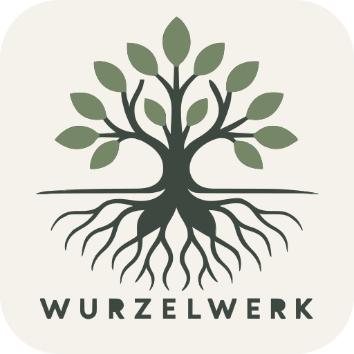

# Wurzelwerk – clans & families board

<p align="center"></p>

Rust 1.99 · iced 0.14 (wgpu) · embedded RedDB (`reddb-io` 1.23, document model)

```
cargo run --release                          # last used workspace (asks for one on first start)
cargo run --release -- D:\families\weber     # open this workspace for one run
cargo run --release -- --demo 40x250         # empty workspace + 10 000 generated people (load test)
```

## Settings, workspaces, updates
* Global settings (language, current + recent workspaces, update check) are stored in
  `~/.config/wurzelwerk/settings.json` on Linux (`$XDG_CONFIG_HOME` honoured) and Windows (`%USERPROFILE%\.config`),
  `~/Library/Application Support/wurzelwerk/settings.json` on macOS. *Settings → About* shows the exact path.
* On first start (no saved workspace) the app asks for a location and creates the workspace there.
  Switch or create workspaces in *Settings → Workspace* (or the workspace button in the toolbar).
* UI languages: English and German (`src/i18n.rs`; English text is the key).
* Update check: the latest GitHub release of `iocast/wurzelwerk` (`vX.Y.Z` tag) is compared with the
  `Cargo.toml` version at start-up (can be disabled) or via *Settings → Updates → Check now*.

## Workspace folder
```
<workspace>/
├─ wurzelwerk.rdb            embedded RedDB (single file + WAL)
└─ files/<person-id>/...     attachments (copied in on drop / "choose…")
```

## RedDB – document collections
| collection | document `body` |
|---|---|
| `sb_people` | `{"id": "...", "data": {name, born, died, x, y, clans[]}}` |
| `sb_clans`  | `{"id": "...", "data": {name, color, label_offset}}` |
| `sb_links`  | `{"id": "...", "data": {from, to, label, route, label_position}}` |
| `sb_files`  | `{"id": "...", "data": {person, name, rel_path, size}}` |

* Open: `RedDBRuntime::with_options(RedDBOptions::persistent(path))`
* Collections are provisioned as native document collections with `CREATE DOCUMENT IF NOT EXISTS`.
* Write: `INSERT INTO <coll> DOCUMENT VALUES (<json-document>)`, update = `DELETE … WHERE body.id = …` + insert
* Read: `SELECT body."data" AS payload FROM <coll>` (RedDB document paths use dotted notation; `"data"` is quoted because it is a keyword)
* All writes run on a dedicated worker thread (UI never blocks), `checkpoint()` when the queue is drained.
* All RedDB code is in `src/store.rs` (`Store`).

## UI
Toolbar: sidebar toggle · workspace switcher · tools (Select · Clan · Person · Connect) · Auto-layout · Fit · Search · light/dark · Settings
Left (collapsible sections, hide with Ctrl+B): clans (colour, member count, + New clan), people (avatar, years; filtered by search) and books
Board: people cards (accent bar in the first clan's colour), orthogonal lines with names, clans as coloured hulls (a person can be in several clans);
clans without members as a dashed box with their name (drag to move, click to open), floating zoom controls, a hint while a tool is active, toasts for notices and a start card on an empty board
Right: person (name, born/died, clan chips, lines, notes, files + drop zone) / clan (colour palette, members, notes) / line (editable relationship, route) / "name the line" form; quick start and shortcuts when nothing is selected
Clan tool: click on the board to place a new clan. Person tool: a click inside an empty clan's box adds the person to that clan; elsewhere the person joins the clan selected in the sidebar (click it again, its ✕ or Esc for no clan).
Deleting a person, clan or book page asks for confirmation (Enter confirms, Esc cancels).
Status: save state · `N people · M clans · L lines` · zoom
Appearance: System / Light / Dark (*Settings → General*, or the moon/sun button in the toolbar). Colours live in `src/ui.rs`.

Keyboard (when no text field has focus): `V` Select · `G` Clan · `P` Person · `C` Connect · `F` fit · `+`/`-`/`0` zoom ·
`Ctrl+F` search · `Ctrl+B` sidebar · `Ctrl+,` settings · `Del` delete selection · `Esc` cancel / deselect

Connect: drag from a person (Connect tool) or from the ◯ handle of the selected person onto another person, then name the line.
`married / siblings / partner` = plain line, `parents of / father of / mother of` = arrow, anything else (e.g. `godfather of`) = dashed arrow.
In Select mode, click a line to select it; the inspector shows its endpoints and a Remove line action, and Delete removes the selected line without deleting a person. Selected lines show corner handles: drag a handle to move either an automatic corner or a saved user bend, then press Delete or choose Remove selected corner to remove a saved bend. Reset to automatic route removes all user bends and port locks. Drag a line label to reposition it relative to its route, drag any line segment (including the first or last segment) to reshape it, or drag a clan label to reposition it relative to its hull. Automatic routes use orthogonal, obstacle-avoiding paths with as few bends as possible; parallel lines that share a gap are spread apart and line labels are placed where they overlap neither cards nor other labels. Manual segment drags save only user-defined bends; generated corners are recalculated and may be simplified or rerouted around cards. Endpoint attachment points can slide along the card edge when the first or last segment moves. Labels follow their route/hull when the connected people move; edits are saved with the document.

Auto-layout groups peers together (partners side by side), places descendants in lower generations, minimises line crossings (barycentre sweeps + transpositions, exact crossing count), centres parents over their children and packs clan groups into a compact board. It clears manually routed bends but leaves labels attached to their routes.

## Large boards (n clans × n people)
* Static board layer is a `canvas::Cache` → tessellated once, redrawn from GPU buffers until data/camera change.
* Uniform spatial grid → only visible nodes are processed (culling), hit-testing is O(1).
* Route cache (`src/routing.rs`): lines are routed once and only re-routed when their inputs change or a card moves inside the area their search looked at, so panning, zooming and hovering never route; dragging a card re-routes only nearby lines.
* Batched paths: all node bodies / solid edges / dashed edges / arrows / clan dots per colour are single paths → few draw calls.
* Level of detail: ≥55 % cards + text · ≥4 % coloured blocks · below a density map. Edge labels ≥70 %.
* Lists in the panels are capped (150 people / 100 lines) – use search.
* Line router: A* over the sparse orthogonal visibility (Hanan) grid of the cards in a search window, cost = length + bend penalty, all ports of both cards searched at once; then nudging centres segments in their free channel and separates overlapping ones.
* Auto-layout (`src/layout.rs`, Sugiyama framework): layered generations, crossing reduction, per-row quadratic coordinate assignment (pool-adjacent-violators) and skyline packing of clan groups.

## Licence
Licensed under either of

* Apache License, Version 2.0 ([LICENSE-APACHE.txt](LICENSE-APACHE.txt))
* MIT license ([LICENSE-MIT.txt](LICENSE-MIT.txt))

at your option.

Dependencies keep their own licences; note that the embedded database `reddb-io` 1.23 is licensed under **BUSL-1.1**.
